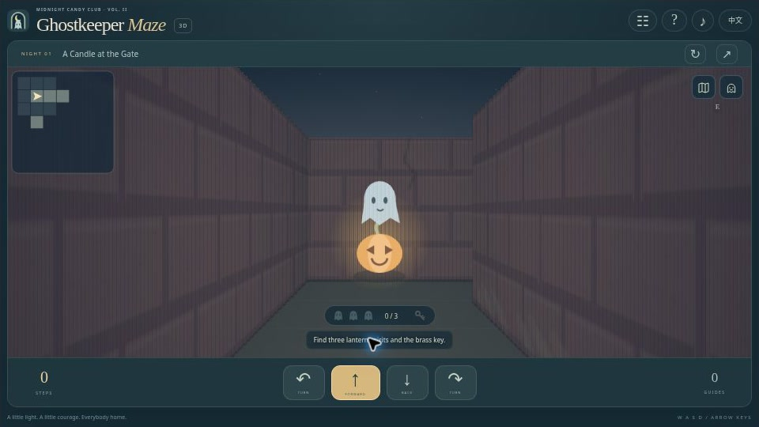
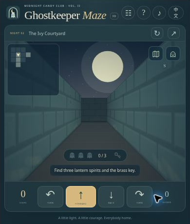

[English](README.md) | [简体中文](README.zh-CN.md) | [Español](README.es.md) | [Português (Brasil)](README.pt-BR.md) | [日本語](README.ja.md)

# 👻 Ghostkeeper Maze 3D — Aventura tranquila en un laberinto de Halloween

**Encuentra tres pequeños espíritus, toma prestada la luz lunar y lleva a todos a casa.** Ghostkeeper Maze 3D es un laberinto de Halloween en primera persona creado para [Crazy 3D](https://crazy3d.org/). Explora pasillos de piedra, reúne tres espíritus de farol y una llave de latón, y abre la puerta lunar. Doce noches y un reto diario te esperan con mapa y guía amistoso.

**[Jugar ahora](https://halloween-haunted-maze.crazy3d.org/)** · [Colección de Halloween](https://github.com/AshinTop/halloween-games) · [Guía de integración](EMBEDDING.md) · [Notas de diseño](DESIGN.md)

**Idiomas de la documentación:** English, 简体中文, Español, Português (Brasil), 日本語. **Interfaz del juego:** solo inglés y chino simplificado. Los otros idiomas del README no implican una traducción de los menús del juego.



## Un paseo nocturno tranquilo 🎃

- **12 aventuras reproducibles**, de 7×7 a 15×15, y un laberinto diario de 11×11.
- Paredes en perspectiva, objetos con profundidad, niebla, luz lunar y resplandor de farol.
- Mapa de exploración, atlas completo opcional y guía hacia los objetivos pendientes.
- Metas de recorrido mínimo, marcas locales, sonido opcional y movimiento reducido.
- Sin enemigos, persecuciones, sustos repentinos, cronómetro ni vidas.

## Cómo llevarlos a casa

Camina sobre cada farol de calabaza para rescatar a su espíritu, recoge la llave y entra en la puerta lunar. Necesitas **los tres espíritus y la llave**. Si llegas antes, la puerta permanece cerrada.

El movimiento sigue la cuadrícula. Avanzar a una casilla abierta contigua cuenta como un paso; girar 90 grados no suma pasos. El objetivo mínimo incluye todos los objetos y la salida, no solo la distancia hasta la puerta.

| Noche | Cuadrícula con bordes | Pasos objetivo |
|---|---|---:|
| 1 | 7×7 | 16 |
| 2 / 3 / 4 | 9×9 | 32 / 34 / 40 |
| 5 / 6 / 7 | 11×11 | 60 / 54 / 48 |
| 8 / 9 / 10 | 13×13 | 94 / 76 / 84 |
| 11 / 12 | 15×15 | 102 / 104 |

## Controles

| Acción | Teclado | Toque / ratón |
|---|---|---|
| Avanzar / retroceder | W o ↑ / S o ↓ | Botones de avance y retroceso |
| Girar izquierda / derecha | A o ← / D o → | Botones de giro |
| Atlas | M | Mapa |
| Guía fantasma | H | Fantasma |
| Noche / reinicio / compartir | Tab y Enter | Botones superiores |

Mantén pulsado un botón de movimiento para repetir. No necesitas bloqueo del puntero, arrastrar ni teclado físico.

## Mapas, ayudas y marcas

El minimapa revela los pasillos cercanos. Abrir el atlas registra **una ayuda** en esa aventura; volver a abrirlo no añade más. Cada petición al guía suma una ayuda y calcula una ruta legal al objeto pendiente más cercano, y finalmente a la salida. Es orientación local, no una garantía del mejor orden global de recogida. La ruta desaparece al recoger un objeto.

Las ayudas no impiden terminar. Las marcas priorizan menos ayudas y después menos pasos. Un atajo asistido no sustituye una marca anterior sin ayuda. Se guardan las noches completadas y preferencias, pero no posiciones inacabadas.

Comparte desde la [noche 1](https://halloween-haunted-maze.crazy3d.org/#night=1) hasta la 12, o una [fecha diaria exacta](https://halloween-haunted-maze.crazy3d.org/#daily=2026-10-31). La generación diaria usa UTC y conserva la fecha elegida.

## Preguntas frecuentes

**¿Se pueden completar todos?** El generador crea laberintos conectados. Las pruebas recorren soluciones completas de las doce noches; el diario usa la misma construcción conectada.

**¿La vista 3D necesita WebGL?** Utiliza un **raycaster de Canvas 2D**, con intersecciones de paredes y objetos comprobados por profundidad.

**¿Puedo explorar despacio?** Sí. No hay amenaza ni cuenta atrás, y las ayudas siguen disponibles.

**¿Qué accesibilidad ofrece?** Movimiento reducido elimina la interpolación de cámara y los adornos animados. Hay textos, inventario y estados, pero el mundo Canvas no proporciona navegación completa con lector de pantalla.

## Imágenes y vídeo



Interfaz real capturada en un iframe compacto del navegador. Ilustra la distribución de los controles; no es una prueba de rendimiento en un teléfono físico.

[Ver la introducción de 24 segundos](https://halloween-haunted-maze.crazy3d.org/intro.html) · [Descargar el MP4 con subtítulos](docs/media/intro.mp4). Este vídeo silencioso está montado con capturas reales del juego, no con una partida grabada de forma continua. Las imágenes reflejan la interfaz del momento de la captura y pueden ser anteriores a mejoras visuales posteriores.

## Añádelo a tu sitio

```html
<iframe src="https://halloween-haunted-maze.crazy3d.org/"
  title="Ghostkeeper Maze 3D"
  style="display:block;width:100%;height:540px;border:0"
  allow="fullscreen" allowfullscreen></iframe>
```

Los tamaños previstos son 960×540, 390×460, 390×300 y 844×340 píxeles CSS. En marcos pequeños se oculta el diario grande, manteniendo escena, inventario, mapa, guía y movimiento. Comprueba la altura real del iframe, especialmente en reproductores bajos.

La versión en línea se publica en Cloudflare desde este repositorio de GitHub. Asigna una altura real al iframe y deja espacio para la barra del sitio anfitrión. El sitio puede ofrecer pantalla completa. Consulta [EMBEDDING.md](EMBEDDING.md) para los detalles.

## Ejecutar y comprobar en local

```sh
python3 -m http.server 4173
```

Sirve la raíz del repositorio y abre [http://localhost:4173/](http://localhost:4173/). Es un juego estático, sin compilación ni instalación de dependencias. Usa HTTP(S): abrirlo mediante `file://` puede bloquear los módulos JavaScript. Las pruebas requieren Node.js.

```sh
npm test
```

Las **10 pruebas** cubren laberintos conectados y cerrados, objetos alcanzables y distintos, soluciones de las doce noches, metas comprobadas con búsqueda independiente de inventario, colisiones, puerta, recogidas, guía, fechas, guardado, rayos de pared y perspectiva de objetos.

El código del juego no necesita cuentas, API remotas, SDK publicitarios ni una CDN de recursos externos. Los registros se guardan en el navegador, sin sincronización en la nube. Cloudflare puede añadir scripts de alojamiento y registros de solicitudes. El sonido sintetizado opcional respeta los permisos del navegador.

## Más aventuras a la luz de la luna 🍬

- [Ghost Lanterns 3D](https://halloween-3d.crazy3d.org/) · [Código](https://github.com/AshinTop/halloween-3d) — Lights Out espacial con faroles enlazados.
- [Pumpkin Shift](https://halloween-pumpkin-shift.crazy3d.org/) · [Código](https://github.com/AshinTop/halloween-pumpkin-shift) — Puzles deslizantes con Moon Glides.
- [Moonlit Mirrors](https://halloween-mirror-hearts.crazy3d.org/) · [Código](https://github.com/AshinTop/halloween-mirror-hearts) — Guía a dos fantasmas reflejados hasta casa.
- [Midnight Rhythm Parade](https://halloween-rhythm-parade.crazy3d.org/) · [Código](https://github.com/AshinTop/halloween-rhythm-parade) — Tres canciones originales y cuatro carriles.

## Créditos y apoyo

Creado para **Midnight Candy Club de AshinTop** mediante colaboración con IA dirigida por personas en diseño, programación, documentación, pruebas y revisión. Las ilustraciones originales y los sonidos sintetizados se hicieron para este proyecto. Consulta las [notas de diseño](DESIGN.md).

¿Te gustó esta pequeña aventura? **[Dale una estrella a Ghostkeeper Maze 3D en GitHub](https://github.com/AshinTop/halloween-haunted-maze)** para encontrarlo después y seguir las novedades. Al informar de un problema, incluye nivel o modo, navegador, tamaño de ventana y pasos para reproducirlo. Descubre la [colección completa de Halloween](https://github.com/AshinTop/halloween-games).
